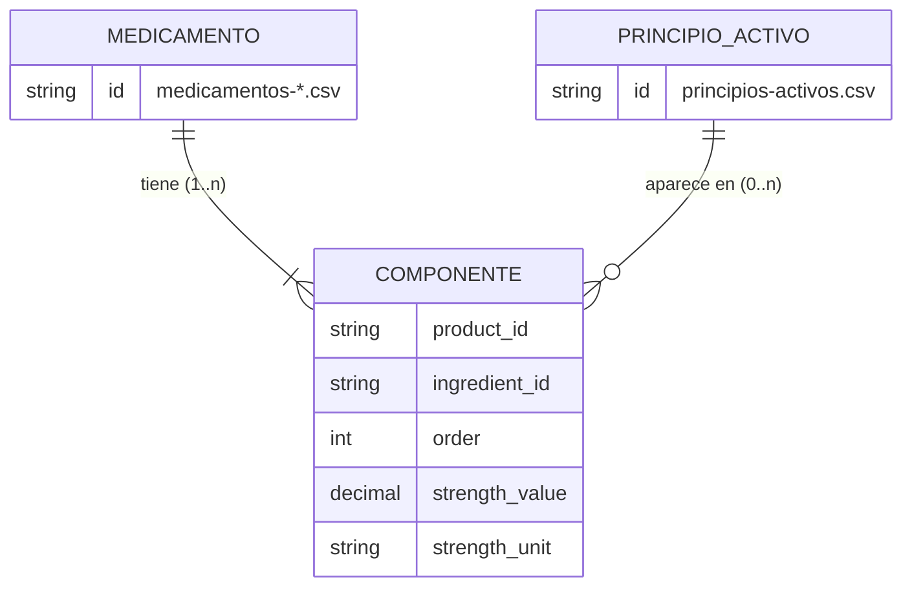

# Medicamentos y principios activos (Ecuador, Colombia y España)

Catálogo unificado de **medicamentos con registro sanitario vigente** y de sus **principios activos**, con las mismas columnas en los tres países y un diccionario común de principios activos. Pensado para autocompletar recetas médicas: se busca por nombre comercial o por principio activo y se obtiene concentración, forma farmacéutica, vía y código ATC.

| Archivo | Contenido | Filas | Fuente |
| :--- | :--- | ---: | :--- |
| `medicamentos-ec.csv` | Ecuador: registros sanitarios vigentes al 19/11/2026 | 6 376 | ARCSA, compilado en `fuentes/arcsa-2026-11-19.xlsx` |
| `medicamentos-co.csv` | Colombia: expedientes con CUM activo (una fila por expediente) | 9 176 | INVIMA, [CUM vigentes](https://www.datos.gov.co/d/i7cb-raxc) |
| `medicamentos-es.csv` | España: medicamentos comercializados | 16 107 | AEMPS, [CIMA](https://cima.aemps.es/cima/publico/home.html) |
| `componentes-ec.csv` / `-co` / `-es` | Un renglón por principio activo de cada producto, con su concentración | 8 979 / 12 329 / 19 136 | Las mismas de su país |
| `principios-activos.csv` | Diccionario común de principios activos (DCI), con ATC y sinónimos | 7 124 | Las tres anteriores + [Wikidata](https://www.wikidata.org/) |
| `rechazados.csv` | Filas descartadas y su motivo | 192 | — |
| `reporte.json` | Conteos, cobertura y formas o vías que no se pudieron clasificar | — | — |

**¿Hay diferencia con Ecuador?** Sí en los productos: cada país registra sus propias marcas, laboratorios y presentaciones, y una receta en Ecuador debe usar lo que se vende ahí (`medicamentos-ec.csv`). No en los principios activos: la DCI es internacional, así que el diccionario es común y Colombia, España y Wikidata lo completan con sinónimos, sales y códigos ATC.



Un medicamento tiene uno o más principios activos (las combinaciones) y un principio activo aparece en muchos medicamentos. `componentes-*.csv` es la tabla que los une, con la concentración de **cada** principio en ese producto.

```text
.
├── medicamentos-{ec,co,es}.csv   # resultado final
├── componentes-{ec,co,es}.csv    # resultado final: producto × principio activo
├── principios-activos.csv        # resultado final
├── rechazados.csv, reporte.json  # control de calidad de la corrida
├── build.py                      # paso 2: normaliza, une y valida
├── scripts/fetch.py              # paso 1: descarga INVIMA, CIMA y Wikidata a source/
├── fuentes/arcsa-*.xlsx          # entrada de Ecuador (no hay descarga pública)
└── source/                       # descargas del paso 1 (no se versiona)
```

## Columnas de `medicamentos-*.csv`

| Columna | Descripción |
| :--- | :--- |
| `country` | `ec`, `co` o `es` |
| `id` | Único por archivo: registro sanitario ARCSA (`ec`), expediente INVIMA (`co`), número de registro AEMPS (`es`) |
| `registration` | Registro sanitario tal como lo publica la autoridad |
| `trade_name` | Nombre comercial |
| `brand` | Marca (`ec`); vacío en genéricos |
| `kind` | `brand` o `generic` (vacío si la fuente no lo dice) |
| `ingredients` | Principios activos limpios, separados por ` + ` |
| `ingredient_ids` | `id` de `principios-activos.csv`, separados por `|`, en el mismo orden |
| `strength` | Concentración legible (`500 mg + 65 mg`, `5 %`, `200 mg/5 mL`) |
| `dosage_form` | Forma normalizada: `tablet`, `capsule`, `syrup`, `suspension`, `solution`, `cream`, `ointment`, `gel`, `drops`, `injectable`, `inhaler`, `pessary`, `suppository`, `patch`, `powder`, `other` |
| `dosage_form_raw` | Forma tal como viene en la fuente |
| `routes` | Vías normalizadas separadas por `|`: `oral`, `sublingual`, `topical`, `ophthalmic`, `otic`, `nasal`, `inhalation`, `intramuscular`, `intravenous`, `subcutaneous`, `rectal`, `vaginal` |
| `route_raw` | Vía tal como viene en la fuente |
| `presentation` | Presentación comercial (envase) |
| `holder`, `holder_country` | Titular del registro y su país (`holder_country` solo en `ec`) |
| `sale_condition` | `prescription`, `otc` o `controlled` (`ec` y `es`) |
| `in_cnmb` | `true`/`false`: pertenece al Cuadro Nacional de Medicamentos Básicos (`ec`) |
| `atc_code` | Código ATC de nivel 5 (o 4 si la fuente no da el 5) |
| `valid_until` | Vigencia del registro (ISO `YYYY-MM-DD`) |

## Columnas de `componentes-*.csv`

| Columna | Descripción |
| :--- | :--- |
| `country` | `ec`, `co` o `es` |
| `product_id` | `id` del producto en `medicamentos-<país>.csv` |
| `order` | Posición del principio en el producto (1, 2...), la misma que en `ingredients` |
| `ingredient_id` | `id` de `principios-activos.csv` |
| `ingredient_name` | Nombre del principio tal como lo da el producto (con su sal) |
| `strength_value` | Cantidad con punto decimal (`500`, `12.5`, `0.6`); vacío si no se pudo leer |
| `strength_unit` | `mg`, `mcg`, `g`, `mL`, `UI`, `mEq`, `mmol`, `nmol` o `%` |
| `per_value`, `per_unit` | Denominador si la cantidad es por volumen o masa (`5` + `mL` en «250 mg/5 mL»; `100` + `g` en una crema); vacío en formas unitarias (tableta, cápsula) |
| `strength_raw` | El texto del que salió la cantidad, para revisarla |

* `(product_id, order)` y `(product_id, ingredient_id)` son únicos en Ecuador: si un producto repite un principio (la sal y el nombre base, como AMLODIPINO BESILATO y AMLODIPINA), queda una fila con el primer nombre y la cantidad informada, o vacía si las dos se contradicen. En Colombia el par puede repetirse: el diccionario todavía junta sales distintas en un mismo `id` (`PA-cloruro`). Cada `ingredient_id` existe en `principios-activos.csv` y cada `product_id` en el archivo de productos de su país.
* La columna `strength` de `medicamentos-*.csv` se arma desde aquí cuando todos los componentes tienen cantidad (`500 mg + 5 mg + 2 mg + 15 mg`, `250 mg/5 mL`).
* **Cómo se lee la cantidad**:
  * **Ecuador**: en la fórmula oficial de ARCSA, la primera cantidad que aparece después del nombre de cada principio. Así, en «Paracetamol DC 90 (equivalente a acetaminofén 500 mg) … 550,00 mg» se toma 500 mg, la dosis, y no el peso del granulado.
  * **Colombia**: viene por principio en INVIMA (`cantidad`, `unidadmedida`, `unidadreferencia`).
  * **España**: CIMA publica una sola dosis por producto y no garantiza el orden en las combinaciones, así que solo se asigna cuando el producto tiene un único principio. En las combinaciones queda vacía: una cantidad asignada al principio equivocado es peor que ninguna.

## Columnas de `principios-activos.csv`

| Columna | Descripción |
| :--- | :--- |
| `id` | Estable entre corridas: `PA-` + la clave normalizada sin sales (`PA-amoxicilina`) |
| `name` | Nombre en español: la etiqueta de Wikidata o la ortografía más frecuente en las fuentes |
| `atc_codes` | Códigos ATC conocidos, separados por `|` |
| `synonyms` | Otras escrituras, sales y el nombre en inglés, separados por `|` |
| `wikidata_id` | `Q…` si se enlazó con Wikidata |
| `products_ec`, `products_co`, `products_es` | Cantidad de productos que lo contienen en cada país |
| `sources` | Fuentes que lo nombran: `ec`, `co`, `es`, `wikidata` |
| `quality` | `verified` si está en Wikidata o lo nombran dos fuentes; `unverified` si solo lo nombra una (revisar antes de usarlo como sugerencia) |

## Control de calidad

Cada corrida aplica estas reglas y deja la evidencia en `rechazados.csv` y `reporte.json`:

* **Rechazo**: fila sin registro, con registro repetido, sin nombre comercial o sin ningún principio activo reconocible.
* **Limpieza del principio activo**: quita cantidades, unidades, farmacopeas (`USP`, `BP`), paréntesis y texto de fórmula (`cada … contiene`, `exceso`, `pellets`, `núcleo`); de «X equivalente a Y» conserva Y; descarta lo que no parece un nombre (menos de tres letras, más de seis palabras, palabras de envase).
* **Unión**: dos nombres son el mismo principio si coinciden sin tildes, mayúsculas, sales ni hidratos (`clorhidrato de metformina` → `metformina`), o si Wikidata los da como alias.
* **Formas y vías** sin regla quedan como `other` o vacías y se cuentan en `reporte.json` (`unmapped_top`).

## Licencias y atribución

| Fuente | Licencia | Atribución |
| :--- | :--- | :--- |
| INVIMA, datos.gov.co | [CC BY-SA 4.0](https://creativecommons.org/licenses/by-sa/4.0/) | Instituto Nacional de Vigilancia de Medicamentos y Alimentos (INVIMA), Colombia |
| AEMPS, CIMA | Reutilización con cita de la fuente | Agencia Española de Medicamentos y Productos Sanitarios (AEMPS) |
| Wikidata | CC0 | — |
| ARCSA | Información pública de registros sanitarios de Ecuador, compilada a mano | Agencia Nacional de Regulación, Control y Vigilancia Sanitaria (ARCSA) |

* `medicamentos-co.csv` y `principios-activos.csv` (que incorpora datos de INVIMA) se distribuyen bajo **CC BY-SA 4.0**.
* Solo se publica el **código** ATC: los nombres de los grupos ATC del WHOCC no se redistribuyen.
* No es una fuente clínica oficial: verifica en la autoridad sanitaria antes de una decisión regulatoria.

## Reproducir

```bash
python3 scripts/fetch.py                                        # descarga INVIMA, CIMA y Wikidata a source/
uv run --python 3.12 --with openpyxl python build.py           # genera los CSV, rechazados.csv y reporte.json
```

Para actualizar Ecuador (productos nuevos o descontinuados), reemplaza `fuentes/arcsa-<fecha>.xlsx` por una compilación nueva con las mismas hojas y columnas, y vuelve a correr `build.py`.

**CSV:** separador `,`, UTF-8 sin BOM, comillas solo cuando hacen falta, fin de línea `\n`, encabezado en la primera fila. Léelos como texto (`dtype=str` en pandas) para no perder ceros ni códigos.
